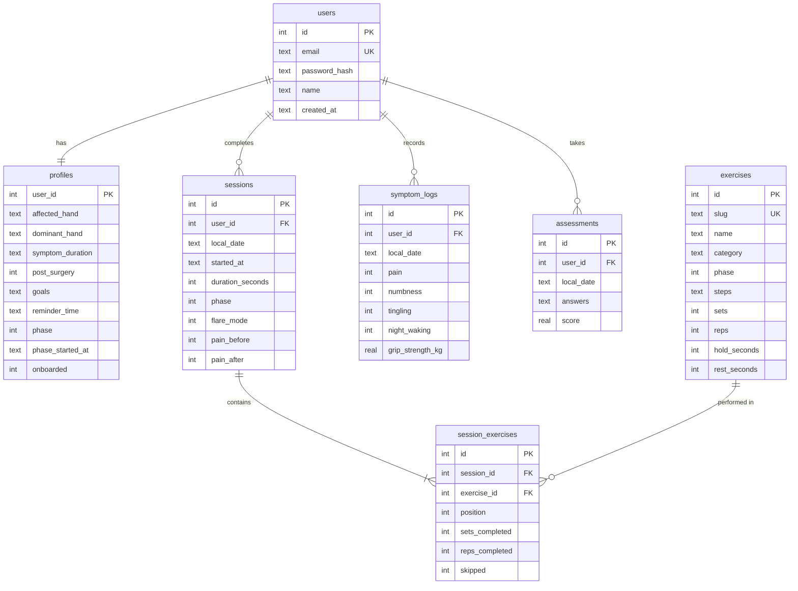

# GripWise

GripWise is a full-stack web app for carpal tunnel rehabilitation. It guides people through a daily routine of nerve and tendon glides, stretches and light strengthening. A timer paces every hold, and users log symptoms so they can see whether the routine is helping.

- **Client:** React 19, TypeScript, Vite, Tailwind CSS v4, TanStack Query, React Router, Recharts
- **Server:** Node.js, Express 5, TypeScript, Zod validation, JWT session cookie
- **Database:** SQLite through `better-sqlite3`, with versioned SQL migrations

> GripWise offers general exercises and tracking. It does not diagnose or treat any condition and is not a substitute for a doctor or hand therapist.

## Features

| Area | What it does |
| --- | --- |
| Accounts | Register, sign in and out, delete the account and all its data (password confirmed) |
| Onboarding | Affected hand, dominant hand, symptom duration, past surgery, goals, practice time, safety acknowledgement |
| Daily routine | Built from the user's current phase. If the latest pain score is 7/10 or higher, it switches to a gentle glides-only routine |
| Guided session | Pain check-in, then a timed player (get ready, hold, relax, rest between sets) with sound, vibration and screen wake lock. Exercises can be skipped or paused, and a session can end early. Pain check-out gives feedback on the change |
| Three-phase programme | *Calm & glide*, then *Restore flexibility*, then *Rebuild strength*. A phase unlocks after 6 sessions, a 7-day average pain of 3/10 or less, and no recent sessions that made pain worse. Users can step back a phase at any time |
| Symptom log | Pain, numbness and tingling (0–10), night waking, optional grip strength in kg, notes |
| Weekly check | 11 questions adapted from the Boston Carpal Tunnel Questionnaire symptom scale, scored 1–5 and compared with the last check |
| Progress | Streaks, totals, symptom trends, sessions per day or week, weekly scores and grip strength over 30 or 90 days, each with a table view |
| Exercise library | 13 exercises with steps, dose, equipment and cautions. Later phases can be previewed |
| Reminders | Downloads a repeating `.ics` calendar event at the user's practice time |

## Getting started

Requires Node.js 20.12 or newer (22 recommended).

```bash
npm install
npm run db:demo   # optional: demo account with four weeks of history
npm run dev       # API on :4000, app on http://localhost:5173
```

Demo login: `demo@gripwise.app` / `gripwise-demo`

The SQLite file is created automatically at `server/data/gripwise.db`. Migrations run, and the exercise library is seeded, every time the server starts. `npm run db:reset` deletes the file and starts fresh.

### Configuration

Copy `server/.env.example` to `server/.env` to override defaults.

| Variable | Default | Notes |
| --- | --- | --- |
| `PORT` | `4000` | API port |
| `JWT_SECRET` | dev-only value | **Required** when `NODE_ENV=production` |
| `DATABASE_FILE` | `server/data/gripwise.db` | Path to the SQLite file |
| `TRUST_PROXY` | `false` | Set `true` behind a reverse proxy |
| `COOKIE_SECURE` | `true` in production | Set `false` to run a production build over plain HTTP |

### Production

```bash
npm run build
NODE_ENV=production JWT_SECRET=change-me npm start   # serves the app and API on :4000
```

Or with Docker (the database lives in the `/data` volume):

```bash
docker build -t gripwise .
docker run -p 4000:4000 -e JWT_SECRET=change-me -v gripwise-data:/data gripwise
```

## Project structure

```
client/                 React app (Vite)
  src/api/              fetch wrapper, response types, React Query hooks
  src/components/       UI kit, app shell, pain scale, charts, route guards
  src/pages/            one file per screen
  src/lib/              dates, exercise metadata, audio/vibration cues, calendar reminder
server/                 Express API
  src/db/               connection, migrations, exercise library seed
  src/routes/           auth, profile, exercises, program, sessions, symptoms, assessments, insights
  src/services/         programme rules, assessment scoring, auth helpers
  src/scripts/          db:reset and db:demo
  test/                 API and unit tests (Vitest + Supertest, in-memory SQLite)
```

## Database



- Schema changes go in `server/src/db/migrations.ts` as a new numbered migration. They are applied once and recorded in `schema_migrations`.
- `CHECK` constraints enforce score ranges and enums in the database as well as in the API.
- Deleting a user cascades to all of their data.
- Records store the user's own calendar date (`local_date`), so streaks and "today" follow the user's timezone rather than the server's.

## API

Every route except `/api/health` and `/api/auth/*` requires the `gw_session` cookie. Request bodies are validated with Zod, and errors come back as `{ "error": string, "details"?: [...] }`.

| Method | Path | Purpose |
| --- | --- | --- |
| POST | `/api/auth/register` · `/api/auth/login` · `/api/auth/logout` | Account and session (sign-in is rate limited) |
| GET | `/api/auth/session` | Current account, or `null` when signed out |
| GET | `/api/auth/me` | Current account (401 when signed out) |
| DELETE | `/api/auth/account` | Delete the account `{ password }` |
| GET / PATCH | `/api/profile` | Read or update profile and onboarding answers |
| GET | `/api/exercises` · `/api/exercises/:slug` | Library with unlock state |
| GET | `/api/program/today?today=&painNow=` | Today's routine, adapted to pain |
| GET | `/api/program/progress` | Phase criteria and eligibility |
| POST | `/api/program/phase` | Advance (when eligible) or step back `{ phase }` |
| POST / GET | `/api/sessions` · GET `/api/sessions/:id` | Save a session (returns feedback and progress), list, detail |
| POST / GET / DELETE | `/api/symptoms` · `/api/symptoms/:id` | Symptom log |
| GET | `/api/assessments/questions` | Weekly check questions |
| POST / GET | `/api/assessments` | Submit a check (returns score, band, previous) and list history |
| GET | `/api/insights/dashboard?today=` | Home screen summary |
| GET | `/api/insights/progress?today=&days=` | Chart series and totals |

## Scripts

| Command | Does |
| --- | --- |
| `npm run dev` | API (watch mode) and Vite dev server together |
| `npm test` | Server test suite |
| `npm run typecheck` | TypeScript checks for both workspaces |
| `npm run build` | Production build of client and server |
| `npm run db:demo` | Create or refresh the demo account |
| `npm run db:reset` | Delete and recreate the local database |

## Design note

The UI was designed from the project brief. The Stitch design for this project (screen `cd1268ccb0c44b3380594bb8787c99ab`) couldn't be fetched, because Stitch requires a Google sign-in and that screen was still generating. Colours, type and spacing live as tokens in `client/src/styles.css`, so they can be aligned with the Stitch screens once they are exported.
