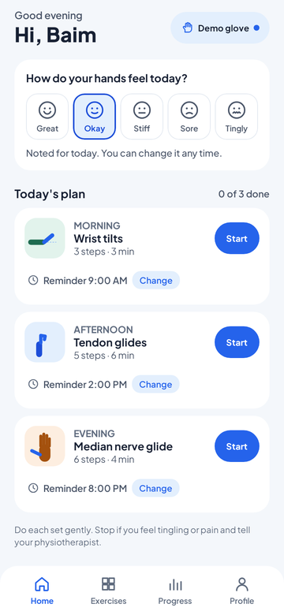
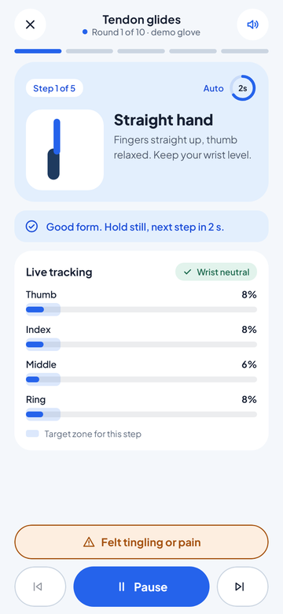
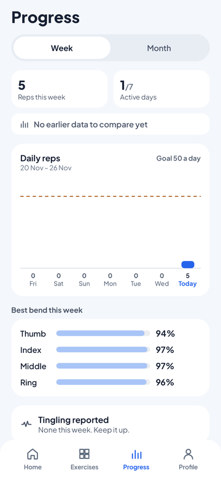
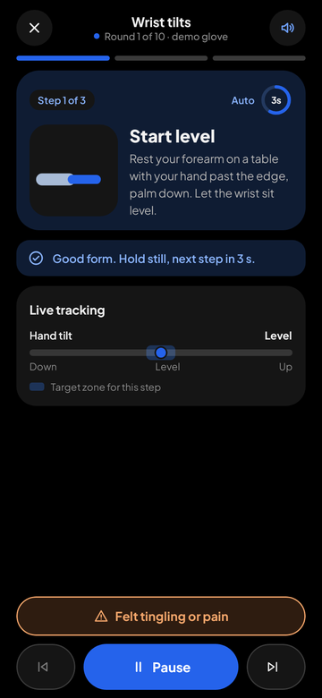

# Gripwise

Android app for the Gripwise smart glove, a final year project at UiTM Shah Alam for carpal tunnel syndrome (CTS) rehabilitation. The glove measures how each finger bends and how the wrist is tilted. The app guides the exercises hands-free, checks your form live and keeps a record of your recovery on your phone.

<p>
  
  
  
  
</p>

## Download and install

1. On your Android phone, open the [latest release](https://github.com/ismibaim-dev/tangan-itik/releases/latest) and download `gripwise-vX.Y.Z.apk`.
2. Open the file. If Android asks, allow your browser or Files app to install unknown apps.
3. Open **Gripwise**.

You need Android 8.0 or newer with Bluetooth. Each APK has a matching `.sha256` file if you want to check the download.

**Coming from version 2.0.0?** Uninstall it first. It was signed with a different key, so Android won't install 3.0.0 over it.

## Connect the glove

1. Flash `firmware/gripwise_glove.ino` to the ESP32 (it is the calibrated sketch, unchanged). It works with `csvAppMode` set to `false` or `true`.
2. Power the glove on. It shows up as **Gripwise_Glove** (Classic Bluetooth).
3. Optional but faster: pair it in your phone's Bluetooth settings.
4. In the app, tap **Get started**, enter your first name, then tap **Allow Bluetooth** (Android calls it *Nearby devices*). The app finds the glove and shows live readings from all 5 sensors.
5. Calibrate: hold an open hand, a gentle fist and a flat wrist for 3 seconds each.

| Problem | Try this |
|---|---|
| "No glove found" | Check the glove has power, hold the phone within 1 m, pair Gripwise_Glove in Bluetooth settings, then tap **Search again**. |
| Android 8–11 finds nothing | Scanning needs Location turned on in quick settings. Pairing first avoids this. |
| Permission denied | Tap **Open settings**, then Permissions, and allow Nearby devices. |
| Readings look wrong | Profile > Glove & calibration > **Recalibrate all**. The app warns you if a sensor barely moves between open hand and fist. |
| Drops during a session | The timer pauses and the app reconnects by itself. Keep the phone close; the screen stays on during a session. |

## Try it without the glove

On the welcome screen tap **Try with the demo glove**, or switch on Profile > Demo glove. The demo glove moves toward each pose the screen asks for, with some noise and a finger that lags now and then, so you can see the hints, holds and progress work.

## What the app does

- **Live session:** bend bars per finger and a wrist tilt meter. The hold timer counts down only while every target is in range, and moves to the next step on its own. Short slips are forgiven. Pause, back, skip, a sound and vibration cue, and a hint telling you which finger to fix.
- **Felt tingling or pain:** stops the set and saves the symptom to your log.
- **8 exercises:** 4 routines (tendon glides, wrist tilts, median nerve glide, grip and release) and 4 single moves.
- **Home:** daily check-in and today's morning, afternoon and evening plan, each with a reminder time.
- **Progress:** week and month reps, active days, change from the last period, best bend per finger and tingling reports.
- **Export:** CSV files or a PDF report for your physiotherapist, saved to the phone or shared.
- **Light, dark and system themes.**

## How it works

```
ESP32 glove ──SPP, 1 line / 400 ms──▶ BluetoothGlove ──▶ PacketParser ──▶ GripwiseProcessor ──▶ SessionEngine ──▶ Room
  4 flex sensors (raw 0–4095)          finds, connects,   readable or CSV   calibration → % bend,   hold timer,       sessions, steps,
  MPU6050 accel X/Y (m/s²)             reconnects         line → frame      smoothing, wrist angle  auto-advance      symptoms, raw frames
```

| Firmware sends | App uses it as |
|---|---|
| `Thumb`, `Index`, `Middle`, `Ring` raw ADC | Bend % per finger, from your calibration (0 % open hand, 100 % gentle fist, either sensor direction) |
| `Wrist(X,Y)` accel X | Wrist tilt in degrees, `asin(ax / 9.81)` minus your flat-wrist reading (positive = hand up) |
| `Wrist(X,Y)` accel Y | Recorded in the raw data export |
| `ACTION` state | Recorded with each frame |

The firmware sends no battery level, so the app doesn't show one.

```
app/src/main/java/io/github/ismibaimdev/gripwise/
  glove/        Bluetooth link, demo glove, line parser
  processing/   calibration, smoothing, session engine
  exercises/    exercise steps, targets and pictograms
  data/         Room database, settings, progress maths
  reminders/    daily notifications
  export/       CSV and PDF export
  ui/           Compose theme, components and screens
design/         the approved design and clickable simulator
firmware/       the ESP32 sketch
```

## Privacy

Everything stays on the phone. There is no account, no server and no internet permission. Profile > Delete my data erases it all.

## Build from source

You need JDK 17 or newer and the Android SDK (platform 36).

```bash
./gradlew assembleDebug          # app/build/outputs/apk/debug/app-debug.apk
./gradlew testDebugUnitTest      # unit tests + a Robolectric walk-through of the whole app
./gradlew testDebugUnitTest --tests '*AppFlowTest*' -Pscreenshots   # also saves every screen to app/build/screenshots
```

## Releasing

1. Add a `## [X.Y.Z] - date` section to `CHANGELOG.md`.
2. Tag and push: `git tag vX.Y.Z && git push origin vX.Y.Z`.

The release workflow tests the code, builds the APK and publishes it with that changelog section as the notes.

APKs are signed with the repo's public debug key until you add a release key. To use your own key, create one and add four repository secrets (Settings > Secrets and variables > Actions):

```bash
keytool -genkeypair -keystore gripwise.jks -alias gripwise -keyalg RSA -keysize 2048 -validity 10000
base64 -w0 gripwise.jks   # paste the output as ANDROID_KEYSTORE_BASE64
```

Then add `ANDROID_KEYSTORE_PASSWORD`, `ANDROID_KEY_ALIAS` (`gripwise`) and `ANDROID_KEY_PASSWORD`. Keep the `.jks` file safe. Switching keys means one more uninstall and reinstall.

## Disclaimer

Gripwise supports, and does not replace, advice from your doctor or physiotherapist. Stop any exercise that causes tingling, numbness or pain.

The font is Plus Jakarta Sans, under the SIL Open Font License (`FONT-LICENSE.txt`).
