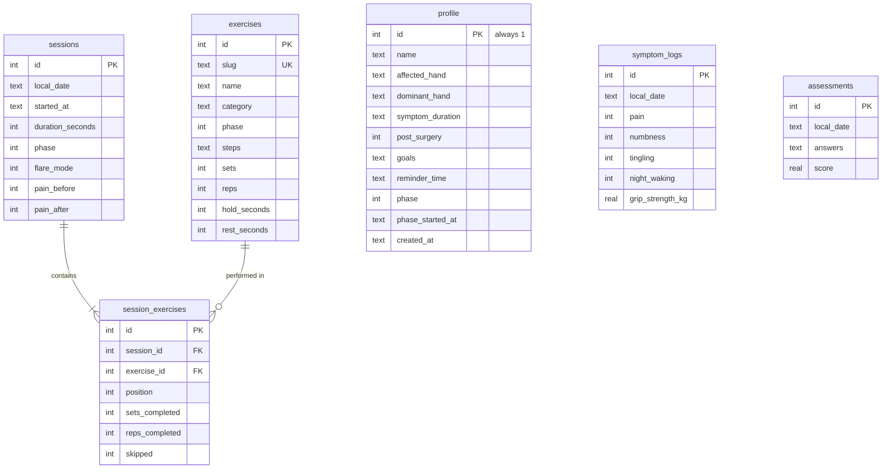

# GripWise

GripWise is an Android app for carpal tunnel rehabilitation. It guides you through a daily routine of nerve and tendon glides, stretches and light strengthening, with a timer that paces every hold, and a simple log that shows whether the routine is helping.

**Everything stays on your phone.** There's no account and no server, and the app makes no network requests. You can export all your data as CSV files at any time.

> GripWise offers general exercises and tracking. It does not diagnose or treat any condition and is not a substitute for a doctor or hand therapist.

## Install on Android

Requires Android 6.0 or newer with an up-to-date **Android System WebView** (version 111 or later, which the Play Store installs automatically on most phones). If it's too old, the app says so and explains how to update it.

1. On your phone, open the latest release: **https://github.com/ismibaim-dev/tangan-itik/releases/latest**
2. Under **Assets**, tap `gripwise-vX.Y.Z.apk` to download it.
3. Open the downloaded file. The first time, Android asks you to allow installs from your browser or Files app: tap **Settings**, allow it, then go back and tap **Install**.
4. Google Play Protect may warn that the app comes from an unknown developer, because it isn't from the Play Store. Tap **More details > Install anyway**.

To check the download wasn't altered, compare its SHA-256 hash with the `.sha256` file attached to the same release.

## Features

| Area | What it does |
| --- | --- |
| Onboarding | First name, affected and dominant hand, symptom duration, past surgery, goals, daily practice time and a safety acknowledgement |
| Daily routine | Built from your current phase. If your latest pain score is 7/10 or higher, it switches to a gentle glides-only routine |
| Guided session | Pain check-in, then a timed player (get ready, hold, relax, rest between sets) with sound, vibration and the screen kept on. Exercises can be skipped or paused, and a session can end early. A pain check-out gives feedback on the change |
| Three-phase programme | *Calm & glide*, then *Restore flexibility*, then *Rebuild strength*. A phase unlocks after 6 sessions, a 7-day average pain of 3/10 or less, and no recent sessions that made pain worse. You can step back a phase at any time |
| Symptom log | Pain, numbness and tingling (0–10), night waking, optional grip strength in kg, notes |
| Weekly check | 11 questions adapted from the Boston Carpal Tunnel Questionnaire symptom scale, scored 1–5 and compared with your last check |
| Progress | Streaks, totals, symptom trends, sessions per day or week, weekly scores and grip strength over 30 or 90 days, each with a table view |
| Exercise library | 13 exercises with steps, dose, equipment and cautions. Later phases can be previewed |
| Reminder | A daily notification at your practice time, switched on or off in Profile |
| Your data | Export everything as CSV, or erase everything, from Profile |

## Your data

- **Where it's stored:** a SQLite database file in the app's private storage, which other apps can't read.
- **Uninstalling deletes it.** Android's own app backup may include it if backup is turned on for your phone, but don't rely on that: export a copy now and then.
- **Erase all data** in Profile deletes everything and returns the app to the welcome screen.
- **Export all data (CSV)** in Profile creates five files and opens Android's share sheet, so you can save them to Files or Google Drive, or email them.

| File | One row per | Columns |
| --- | --- | --- |
| `gripwise-profile-<date>.csv` | profile | name, affected_hand, dominant_hand, symptom_duration, post_surgery, goals, reminder_time, phase, phase_started_at_utc, created_at_utc |
| `gripwise-sessions-<date>.csv` | session | session_id, date, started_at_utc, completed_at_utc, duration_seconds, phase, gentle_routine, pain_before, pain_after, pain_change, exercises_done, exercises_total, notes |
| `gripwise-session-exercises-<date>.csv` | exercise in a session | session_id, date, order, exercise, category, sets_completed, reps_completed, skipped |
| `gripwise-symptom-logs-<date>.csv` | symptom log | log_id, date, logged_at_utc, pain, numbness, tingling, night_waking, grip_strength_kg, notes |
| `gripwise-weekly-checks-<date>.csv` | weekly check | check_id, date, taken_at_utc, score, severity, then one column per question (night_pain … grip_small_objects), each answer 1–5 |

The files are UTF-8 with a byte-order mark, so Excel and Google Sheets open them correctly. `date` is your local calendar date, and `*_utc` columns are ISO 8601 timestamps in UTC. Text that a spreadsheet would treat as a formula starts with an apostrophe.

## Development

GripWise is a React app (Vite, TypeScript, Tailwind CSS v4, TanStack Query, Recharts) packaged for Android with [Capacitor](https://capacitorjs.com/). The database is SQLite compiled to WebAssembly ([sql.js](https://sql.js.org/)).

Requirements: Node.js 20.19 or newer (22 recommended). To build the APK you also need JDK 21 and the Android SDK (platform 35), which [Android Studio](https://developer.android.com/studio) installs for you.

```bash
npm install
npm run dev         # the app in a browser at http://localhost:5173 (data kept in IndexedDB)
npm test            # data layer tests on an in-memory SQLite database
npm run typecheck
npm run android:apk # builds client/android/app/build/outputs/apk/debug/app-debug.apk
```

To run on a phone connected over USB with developer mode on: `adb install -r client/android/app/build/outputs/apk/debug/app-debug.apk`. To work in Android Studio, run `npx cap open android` from `client/`.

Every pull request also builds a debug APK in CI, which you can download from the run's **Artifacts** to try on a phone.

### Project structure

```
client/
  src/data/        on-device database: schema, exercise library, programme rules, queries, CSV export, storage
  src/pages/       one file per screen
  src/components/  UI kit, app shell, pain scale, charts, route guards
  src/lib/         dates, notifications, export delivery, timer cues
  android/         Capacitor's native Android project
```

### Database



- Schema changes go in `client/src/data/schema.ts` as a new numbered migration. Never edit one that has shipped: phones that already applied it won't run it again.
- `CHECK` constraints enforce score ranges and allowed values in the database as well as in the code.
- The database is saved after every change. On Android it's written to a temporary file first and then swapped in, so an interrupted save can't corrupt it.

## Releasing

1. Add a section for the new version to `CHANGELOG.md`, headed like `## [2.1.0] - 2026-11-30`.
2. Create the tag, either with `git tag v2.1.0 && git push origin v2.1.0`, or on GitHub with **Releases > Draft a new release**, typing `v2.1.0` as a new tag on `main`, then **Publish**.
3. The **Release** workflow runs the checks, builds the APK and attaches `gripwise-v2.1.0.apk` and its `.sha256` to the release, using the changelog section as the notes.

### Signing key (set up once)

Android only installs an update over an existing app if both are signed with the same key. Without one, the workflow attaches a debug-signed APK and adds a note to the release: users then have to export their data, uninstall and reinstall to update.

To sign releases properly, create a key once with `keytool` (it comes with JDK 21 and Android Studio):

```bash
keytool -genkeypair -v -keystore gripwise-release.keystore -alias gripwise \
  -keyalg RSA -keysize 2048 -validity 10000
base64 -w 0 gripwise-release.keystore > gripwise-release.keystore.b64   # macOS: base64 -i gripwise-release.keystore
```

Then add these under **Settings > Secrets and variables > Actions** in the repository:

| Secret | Value |
| --- | --- |
| `ANDROID_KEYSTORE_BASE64` | contents of `gripwise-release.keystore.b64` |
| `ANDROID_KEYSTORE_PASSWORD` | the keystore password you chose |
| `ANDROID_KEY_ALIAS` | `gripwise` |
| `ANDROID_KEY_PASSWORD` | the key password (the same as the keystore password if you pressed Enter) |

Keep the keystore file and passwords somewhere safe and never commit them. If the key is lost, no future version can update existing installs.

## Design note

The UI was designed from the project brief, because the Stitch design for this project couldn't be fetched (Stitch needs a Google sign-in, and the screen was still generating). Colours and type are tokens in `client/src/styles.css`, with matching Android colours in `client/android/app/src/main/res/values/colors.xml`.
